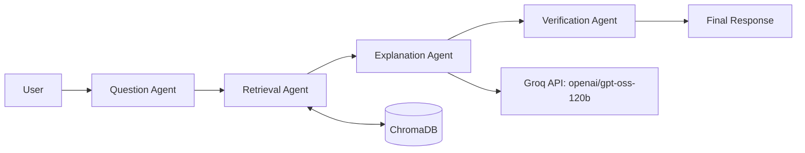
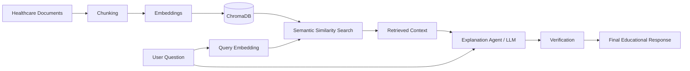

# Healthcare FAQ Multi-Agent RAG System

**Team: Agentic Minds**

> An educational healthcare FAQ prototype that combines local document retrieval with a four-agent response workflow.

## Project Overview

Healthcare FAQ Multi-Agent RAG System is a Python and Streamlit hackathon prototype. It accepts a healthcare question, classifies it into a supported domain, retrieves relevant passages from a local ChromaDB knowledge base, generates an educational response with Groq's `openai/gpt-oss-120b` model, and applies basic response/context handling before displaying the result.

The current knowledge base consists of **synthetic educational healthcare documents created for the hackathon demonstration**. These documents are not real clinical records, approved medical guidance, or a substitute for professional care.

## Problem Statement

General healthcare information can be difficult to navigate, while broad language-model answers may not be grounded in a particular source collection. This prototype demonstrates a way to retrieve relevant passages from a small, curated-for-demo local collection and present an explanation alongside the workflow and source filenames.

## Proposed Solution

The system organizes question analysis, local retrieval, explanation generation, and basic response validation into four cooperating Python agents. A Streamlit interface presents the resulting answer as well as the retrieved passages and an overview of the processing stages.

## Objectives

- Demonstrate retrieval-augmented generation over a small healthcare FAQ collection.
- Separate question classification, retrieval, explanation, and validation into distinct agents.
- Show the process and supporting source filenames through a Streamlit interface.
- Keep the response educational and communicate the prototype's limitations.

## How the System Works

1. A user submits a healthcare question in Streamlit.
2. The Question Agent uses keyword-based rules to identify a domain, topic, intent, question type, and a basic safety classification.
3. The Retrieval Agent asks the local ChromaDB collection for up to four semantically similar chunks, using the detected domain when available.
4. The Explanation Agent sends the question and retrieved context to the Groq-hosted language model and requests an educational response grounded in that context.
5. The Verification Agent applies basic response/context handling and appends an educational disclaimer.
6. Streamlit displays the answer, source passages, agent summaries, and other run details in tabs.

## Multi-Agent Architecture



### The Four Agents

| Agent | Responsibility in this prototype |
|---|---|
| **Question Agent** | Applies keyword rules to classify the question's domain, topic, intent, type, and basic safety category. Supported domain labels are `RESPIRATORY`, `CARDIAC`, `DIGESTIVE`, and `UNKNOWN`. |
| **Retrieval Agent** | Calls the retriever, which embeds the question and searches ChromaDB for up to four relevant document chunks, optionally filtering by the detected domain. |
| **Explanation Agent** | Provides the question, analysis, and retrieved passages to the LLM to generate an educational explanation. Its prompt instructs the model to use retrieved information, avoid personalized diagnosis or prescriptions, and identify when the sources do not support a section. |
| **Verification Agent** | Handles an empty response and a no-source fallback, then adds a synthetic-content and professional-care disclaimer. This is basic response/context validation, **not an independent medical fact-checking system**. |

## RAG Pipeline



### RAG Components

- **Document processing:** `python -m rag.ingest` scans `documents/` for `.txt` files, records source and domain metadata, and prepares their contents for indexing. The ingestion module also creates missing synthetic source documents without overwriting documents that already exist.
- **Chunking:** Text is divided into windows of up to 500 characters with 100 characters of overlap. Overlap helps preserve some context across neighboring chunks.
- **Embeddings:** Sentence Transformers converts each document chunk into a numeric vector. During retrieval, the user's question is embedded using the same model.
- **Sentence Transformers:** The Python `sentence-transformers` package provides the model used by ingestion and retrieval to encode text.
- **`all-MiniLM-L6-v2`:** The embedding model specified by this project for both document and question embeddings.
- **ChromaDB:** A persistent local vector database stored in `chroma_db/`, using the `healthcare_documents` collection. It stores chunk text, embeddings, and source/domain metadata.
- **Semantic similarity search:** ChromaDB compares the question vector with indexed document vectors and returns up to four matching chunks. When the Question Agent identifies a supported domain, retrieval applies a matching domain filter.
- **LLM generation:** The Explanation Agent sends the question and retrieved source context to the Groq API using `openai/gpt-oss-120b`. The generated answer is intended as an educational explanation based on retrieved material; generation is not a guarantee of correctness.

## Healthcare Knowledge-Base Domains

The source documents are synthetic educational text files organized into these areas:

| Domain | Example topics and documents |
|---|---|
| **Respiratory** | Asthma, common respiratory infections, respiratory health |
| **Cardiac / Cardiovascular** | Hypertension, heart health, cardiovascular risk factors |
| **Digestive** | Acid reflux, common digestive conditions, digestive health |

## Technology Stack

| Technology | Use in this project |
|---|---|
| Python | Application and agent implementation |
| Streamlit | Interactive web application and result tabs |
| Groq API | LLM chat completion requests |
| `openai/gpt-oss-120b` | Model identifier configured for response generation |
| ChromaDB | Persistent local vector storage and retrieval |
| Sentence Transformers | Document and query embedding generation |
| `all-MiniLM-L6-v2` | Configured sentence embedding model |
| `python-dotenv` | Load `GROQ_API_KEY` from a local `.env` file |

## Project Folder Structure

```text
healthcare_multi_agent/
├── agents/
│   ├── explanation_agent.py
│   ├── question_agent.py
│   ├── retrieval_agent.py
│   └── verification_agent.py
├── core/
│   ├── llm.py
│   └── orchestrator.py
├── documents/
│   ├── cardiac/
│   ├── digestive/
│   └── respiratory/
├── rag/
│   ├── create_documents.py
│   ├── ingest.py
│   └── retriever.py
├── chroma_db/             # Persistent local vector database
├── app.py                 # Streamlit application
├── requirements.txt
└── .gitignore
```

## Installation

Open PowerShell in the project directory. Install Python first if it is not already available, then create and activate a virtual environment:

```powershell
python -m venv myvenv
myvenv\Scripts\Activate.ps1
```

If PowerShell blocks activation because of its execution policy, follow your organization's or system administrator's guidance for enabling locally created scripts. You can also use the environment's Python executable directly without activating it.

Install the project dependencies from `requirements.txt`:

```powershell
pip install -r requirements.txt
```

## Environment Setup

Create a local file named `.env` in the project root and put the following placeholder line in it. Replace the placeholder locally with your own Groq API key; do not share the populated value.

```dotenv
GROQ_API_KEY=your_groq_api_key_here
```

The existing `.gitignore` excludes `.env`. **Do not commit `.env` or any API key to GitHub.** The README intentionally contains only a placeholder, not a credential.

## Create or Index the RAG Knowledge Base

With the virtual environment active, run:

```powershell
python -m rag.ingest
```

The command discovers `.txt` files under `documents/`, creates any missing synthetic documents, embeds new chunks using `all-MiniLM-L6-v2`, and stores them in the persistent `chroma_db/` directory. The current project already includes synthetic documents for all three domains. Existing indexed chunk IDs are skipped on subsequent runs.

## Run the Streamlit Application

From the project root, run:

```powershell
streamlit run app.py
```

Streamlit will print a local URL in the terminal. Open that URL, enter a question, and select **Generate Answer**. An LLM response requires a valid `GROQ_API_KEY` in the local `.env` file.

## Example Healthcare Question

> What are common symptoms of asthma?

### Expected Workflow for This Example

1. The Question Agent recognizes the respiratory domain, identifies the topic as asthma, and classifies the question as symptom-related.
2. The Retrieval Agent embeds the question and searches respiratory content in ChromaDB, returning up to four matching chunks.
3. The Explanation Agent sends the question and retrieved excerpts to `openai/gpt-oss-120b` through Groq, requesting an educational response grounded in those excerpts.
4. The Verification Agent applies its basic response/context handling and appends a synthetic-content and professional-care note.
5. The Final Response tab displays the response and source filenames; the other tabs expose the run's summaries and retrieved chunks.

Results depend on the indexed content and the generated model response. This example does not imply a diagnosis or clinical assessment.

## A2A / Agent-to-Agent Communication

In this project, **A2A means Agent-to-Agent handoffs within the Python orchestrator**. The orchestrator calls the four agents in sequence and passes structured values such as the analyzed question, retrieved context, and generated answer. It also builds a list of displayable sender/recipient messages for the A2A Messages tab.

This is an application-level demonstration of agent communication; the code does not implement a separate A2A network protocol or independent agent services.

## Streamlit Application Tabs

After a result is available, the interface shows:

| Tab | What it displays |
|---|---|
| **Orchestration** | Agent purposes, analysis, workflow summary, and retrieved chunk count |
| **A2A Messages** | The orchestrator's recorded sender-to-recipient handoffs |
| **RAG / Vector DB** | Retrieved text chunks, source filenames, domains, and paths |
| **Tools** | A summary of ChromaDB, SentenceTransformer, and Groq LLM activity |
| **Memory** | A per-question summary of the stages; this is not durable conversation memory |
| **Verification** | The run's verification status, domain, and retrieved source count |
| **Final Response** | The generated educational answer and source filenames |

## Key Features

- Four-role, sequential agent orchestration.
- Keyword-based domain and intent classification.
- Local, persistent ChromaDB knowledge base with source metadata.
- Sentence-transformer embeddings and semantic retrieval.
- Optional domain-filtered retrieval and a maximum of four returned chunks.
- Groq-backed educational response generation using retrieved context.
- Streamlit tabs for orchestration, messages, retrieved material, and the final response.
- Basic fallback handling and an educational disclaimer in the response.

## Safety and Scope

This is a hackathon demonstration over **synthetic educational healthcare documents**, not real clinical or approved medical records. The generation prompt asks for general education based on retrieved context and prohibits personalized diagnosis, medication prescriptions, dosages, and individualized treatment plans.

The Verification Agent performs basic response/context validation and adds disclaimer text. It does not independently establish medical accuracy, validate claims against authoritative clinical sources, or guarantee that generated text is free of errors. Do not use the application for urgent symptoms or decisions about care.

## Limitations

- The knowledge base is small and synthetic, and its coverage is limited to respiratory, cardiac/cardiovascular, and digestive topics.
- The Question Agent relies on keyword rules; an unfamiliar phrasing may be assigned `UNKNOWN` or the wrong domain.
- Retrieval quality depends on the available documents, chunking, embeddings, and similarity results.
- The generated response may be incomplete or incorrect, even when context is retrieved.
- The verification stage is basic application logic, not medical review or independent fact-checking.
- LLM generation depends on Groq service availability, network access, and a locally configured API key.
- The Memory tab summarizes one orchestration run; it is not persistent user memory or conversation history.

## Future Enhancements

- Expand the synthetic educational collection and add clear source/version metadata.
- Improve question classification and evaluate retrieval quality across varied wording.
- Add automated tests for ingestion, retrieval, orchestration, and safety-related fallback behavior.
- Improve observability for empty retrievals and model/API errors.
- Consider expert review and authoritative sources before any use beyond an educational demonstration.

## Team

**Agentic Minds**

## Hackathon Disclaimer

This project is an educational hackathon prototype. It does not provide medical diagnosis, personalized treatment, medication prescriptions, or clinical decision-making. Users should consult qualified healthcare professionals for personal health concerns.
